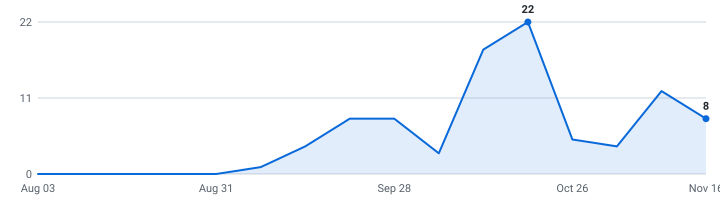

# Indian Tech Internships

   

A self-updating engine that tracks tech internships so you don't have to. Instead of refreshing a dozen career pages by hand, it reads company hiring feeds directly and keeps one live list, newest roles on top, refreshed automatically throughout the day.

**11 open roles · 6 new this week · 5,859 companies tracked · updated Nov 18, 2026 at 11:08 UTC**

**⭐Star this repo⭐** to save it and get updates when new roles are added.

**Live:** [dashboard](https://internship-engine-india.vercel.app/) · [RSS feed](https://raw.githubusercontent.com/Rohan-droid7341/internship-engine-india/main/docs/feed.xml) (instant alerts in any RSS app) · [JSON API](https://internship-engine-india.vercel.app/api/jobs)

**🔔 New roles in your inbox:** [subscribe by email](https://internship-engine-india.vercel.app/#subscribe) — one email a day, only when new internships actually appeared, one-click unsubscribe.
---

## Summer 2027  (11 open)

| Company | Role | Category | Pay & Specs | Location | Posted | Apply |
|---|---|---|---|---|---|---|
| Honeywell | Intern Masters AI ~ 🆕 | Data & ML/AI | ~₹30k–45k/mo (9–14 LPA) M.Tech/MS | Bengaluru, Karnataka, India | Nov 18, 2026 | [Apply](https://ibqbjb.fa.ocs.oraclecloud.com/hcmUI/CandidateExperience/en/sites/CX_1/job/162526) |
| Zebra Technologies | 2027 (6 Month) Internship - (Bengaluru) Software Engineering 🆕 | Software | B.Tech/BS | Bengaluru, India | Nov 18, 2026 | [Apply](https://zebra.wd501.myworkdayjobs.com/Zebra_careers/job/Bengaluru-India/XMLNAME-2027--6-Month--Internship----Bengaluru--Software-Engineering_JR103480) |
| Honeywell | Intern Bachelors Cyber Sec ~ 🆕 | Other | ~₹30k–45k/mo (9–14 LPA) B.Tech/BS | Bengaluru, Karnataka, India | Nov 16, 2026 | [Apply](https://ibqbjb.fa.ocs.oraclecloud.com/hcmUI/CandidateExperience/en/sites/CX_1/job/162491) |
| Honeywell | Intern Bachelors Software Eng ~ 🆕 | Software | ~₹30k–45k/mo (9–14 LPA) B.Tech/BS | Bengaluru, Karnataka, India | Nov 16, 2026 | [Apply](https://ibqbjb.fa.ocs.oraclecloud.com/hcmUI/CandidateExperience/en/sites/CX_1/job/162256) |
| Assurant | AI & Data Science Intern ~ | Data & ML/AI | B.Tech/BS | Bengaluru | Nov 11, 2026 | [Apply](https://assurant.wd1.myworkdayjobs.com/External_Limited_Posting/job/Bengaluru/AI---Data-Science-Intern_R-116198) |
| Workato | Intern, Automation Engineer ~ | Software | B.Tech/BS | Hyderabad, India | Nov 10, 2026 | [Apply](https://www.workato.com/careers?gh_jid=8924723002#open-roles) |
| Thales | Embedded Software Intern ~ | Software | B.Tech/BS | Bangalore | Nov 10, 2026 | [Apply](https://thales.wd3.myworkdayjobs.com/careers/job/Bangalore/Embedded-Software-Intern_R0347902) |
| Thales | Software Intern ~ | Software | B.Tech/BS | Bangalore | Nov 10, 2026 | [Apply](https://thales.wd3.myworkdayjobs.com/careers/job/Bangalore/Software-Intern_R0347867) |
| Revvity | Intern - Software Developer ~ | Software | — | Mumbai | Nov 05, 2026 | [Apply](https://revvity.wd103.myworkdayjobs.com/External/job/Mumbai/Intern---Software-Developer_JR-045916) |
| Certa | Frontend Engineer - Internship ~ | Software | 0-1 Yr | India | Oct 28, 2026 | [Apply](https://jobs.ashbyhq.com/certa/9f7caf0b-46ff-49ab-ae78-62deadec106e) |
| HackerRank | AI Researcher Intern ~ | Data & ML/AI | ~₹40k–60k/mo (16–22 LPA) B.Tech/BS | Onsite in Bangalore | Oct 28, 2026 | [Apply](https://job-boards.greenhouse.io/hackerrank/jobs/8281055) |

_~ = the title doesn't state a year; bucketed here from its posting date (10 of 11)._

## Features

- **📅 [Drop Radar](#drop-radar)** - the only list that shows **what's coming**: each marquee company's typical opening window, then confirmed with the real drop date the moment the engine catches it live.
- **Real posted dates on every role** - pulled from each job portal itself, so newest-first actually means newest.
- **Skill tags + pay, extracted** - every posting's text is scanned for the stack it wants (Python, C++, PyTorch, ...) and the pay it states — searchable on the [dashboard](https://internship-engine-india.vercel.app/) and JSON API.
- **Alerts your way** - [email digests](https://internship-engine-india.vercel.app/#subscribe) or Discord — plus a [live dashboard](https://internship-engine-india.vercel.app/) with search and custom filters.
- **An engine, not a spreadsheet** - polled every 3 hours across multiple ATS platforms with full source in this repo.

## Scope

- **Roles:** Software Engineering, Data Science & Machine Learning (and closely related technical internships)
- **Region:** India & Verified Remote
- **Cycles:** Summer 2027 and Fall 2026

## About

I built this engine to automate tracking for top-tier tech internships across India and globally remote roles. Use it to spot roles early and apply before they fill up - being first genuinely helps.

## How to use

- Roles are grouped by cycle - **newest posting on top, oldest at the bottom.**
- The **Posted** column is the date the company published the role.
- **Flags:** 🆕 = spotted in the last 48 hours.
- Missing a company? Adding one takes a single line, see [CONTRIBUTING.md](CONTRIBUTING.md).

---

## 📅 Drop Radar — when companies usually post for Summer 2027

Stop refreshing career pages. Every date here is **real or verified** — no third-party list. 🎯 = the engine **saw the drop itself** from the company's own careers API; the rest are hand-checked typical opening windows for marquee names. ✅ = already live in the list above.

> **Heads up:** companies trend *earlier* every cycle, and "~Aug" is a month, not a day. Treat "expected" as when to **start watching**, and "rolling" companies as worth checking year-round.

| Company | Typical opening | Expected this cycle | Status |
|---|---|---|---|
| Citadel | ~Aug | ~Aug · any day now | ⏳ waiting |
| Citadel Securities | ~Aug | ~Aug · any day now | ⏳ waiting |
| Databricks | ~Aug | ~Aug · any day now | ⏳ waiting |
| DoorDash | ~Aug | ~Aug · any day now | ⏳ waiting |
| DRW | ~Aug | ~Aug · any day now | ⏳ waiting |
| Google | ~Aug | ~Aug · any day now | ⏳ waiting |
| Jane Street | ~Aug | ~Aug · any day now | ⏳ waiting |
| Meta | ~Aug | ~Aug · any day now | ⏳ waiting |
| Optiver | ~Aug | ~Aug · any day now | ⏳ waiting |
| Pinterest | ~Aug | ~Aug · any day now | ⏳ waiting |
| Salesforce | ~Aug | ~Aug · any day now | ⏳ waiting |
| SIG | ~Aug | ~Aug · any day now | ⏳ waiting |
| Snowflake | ~Aug | ~Aug · any day now | ⏳ waiting |
| Uber | ~Aug | ~Aug · any day now | ⏳ waiting |
| Adobe | ~Sep | ~Sep · any day now | ⏳ waiting |
| Airbnb | ~Sep | ~Sep · any day now | ⏳ waiting |
| Bloomberg | ~Sep | ~Sep · any day now | ⏳ waiting |
| Dropbox | ~Sep | ~Sep · any day now | ⏳ waiting |
| Plaid | ~Sep | ~Sep · any day now | ⏳ waiting |
| Point72 | ~Sep | ~Sep · any day now | ⏳ waiting |
| Robinhood | ~Sep | ~Sep · any day now | ⏳ waiting |
| Roblox | ~Sep | ~Sep · any day now | ⏳ waiting |
| Stripe | ~Sep | ~Sep · any day now | ⏳ waiting |
| D.E. Shaw | ~Oct | ~Oct · any day now | ⏳ waiting |
| Coinbase | ~Dec | ~Dec · in ~13d | ⏳ waiting |
| Ramp | ~Dec | ~Dec · in ~13d | ⏳ waiting |
| Two Sigma | ~Dec | ~Dec · in ~13d | ⏳ waiting |
| Apple | rolling | year-round | ⏳ waiting |
| Datadog | rolling | year-round | ⏳ waiting |
| Jump Trading | rolling | year-round | ⏳ waiting |

_66 companies on the [full radar](https://internship-engine-india.vercel.app/#radar). **31** dated from our own live observations 🎯 (this grows every cycle). "~Aug" = hand-verified typical month, not a promise of the day; "rolling" = posts year-round; "waiting" = not seen in our tracked feeds yet, not a guarantee it isn't out somewhere else._

<strong>Recently closed</strong> — 25 roles taken down in the last 14 days

| Company | Role | Cycle | Closed |
|---|---|---|---|
| Honeywell | Intern Bachelors Software Eng | Summer 2027 | 2026-11-18 |
| Honeywell | Intern Bachelors Cyber Sec | Summer 2027 | 2026-11-18 |
| Honeywell | Intern Bachelors AI | Summer 2027 | 2026-11-17 |
| Honeywell | Intern Bachelors AI | Summer 2027 | 2026-11-16 |
| Marvell | Software Engineer Intern - Master's Degree | Summer 2027 | 2026-11-16 |
| Marvell | Software Validation Intern - Master's Degree | Summer 2027 | 2026-11-16 |
| GE Aerospace | Data Science Intern | Summer 2027 | 2026-11-14 |
| Marvell | Intern, Software Engineer - Bachelor's Degree | Summer 2027 | 2026-11-14 |
| Member Solutions | Cybersecurity GRC Intern | Summer 2027 | 2026-11-14 |
| Valeo | Intern - AI | Summer 2027 | 2026-11-14 |
| GE Healthcare | Software Intern | Summer 2027 | 2026-11-13 |
| Marvell | Intern, Software Engineer | Summer 2027 | 2026-11-13 |
| Honeywell | Intern Bachelors Software Eng | Summer 2027 | 2026-11-12 |
| Sanas | ML DA Intern | Summer 2027 | 2026-11-12 |
| Honeywell | Intern Bachelors AI | Summer 2027 | 2026-11-12 |
| Honeywell | Intern Bachelors Software Eng | Summer 2027 | 2026-11-12 |
| Sigmoid | DE Intern + SDE Trainee - Off Campus Hiring 2026 | Fall 2026 | 2026-11-11 |
| Marvell | Intern, Software QA Engineer Bachelor's Degree | Summer 2027 | 2026-11-09 |
| Honeywell | Intern Bachelors AI | Summer 2027 | 2026-11-06 |
| Marvell | Software Engineer Intern | Summer 2027 | 2026-11-06 |
| Acron Aviation | Software Engineer Intern - India Site | Summer 2027 | 2026-11-05 |
| Honeywell | Intern Bachelors Software Eng | Summer 2027 | 2026-11-05 |
| Marvell | Software Intern | Summer 2027 | 2026-11-05 |
| Honeywell | Intern Bachelors AI | Summer 2027 | 2026-11-05 |
| GE Aerospace | Data Science Intern | Summer 2027 | 2026-11-04 |

---

## Hiring timeline

Internships posted per week, from each role's real published date - redrawn automatically on every run. When this line takes off, recruiting season is open:

<picture>
  <source media="(prefers-color-scheme: dark)" srcset="docs/trends-dark.svg">
  
</picture>

## How it stays current

A small Python engine reads public company hiring feeds directly, keeps the roles that match the scope above, de-duplicates across sources, records each role's published date once (so it never shifts), and regenerates this page through GitHub Actions. It polls every company concurrently (async) with retry/backoff and per-host rate limits. The full source is in this repo.

_Engine (last run): 5,859 companies across 18 ATS platforms · 74% fetch success · completed in 494.9s · median detection latency 773 min · real posted dates on 100% of open roles._

## Platforms Scraped

The engine currently extracts live data from the following platforms:
- **Direct ATS (Applicant Tracking Systems):** Greenhouse, Lever, Ashby, SmartRecruiters, Workable, Workday, Breezy, Recruitee, Rippling, Eightfold, Oracle
- **Direct Enterprise & Custom Scrapers:** Amazon (India Jobs), Custom Playwright Scrapers (Flipkart, Swiggy, Razorpay, CRED, InMobi, Rapido, Blinkit, Groww, CARS24, Urban Company, Delhivery)
- **Indian Job Portals & Aggregators:** Internshala, Wellfound

## Contributing

Adding a company takes one line, see [CONTRIBUTING.md](CONTRIBUTING.md). Suggestions and pull requests are welcome.

Roles can close at any time, so always confirm on the company's own site before applying.
